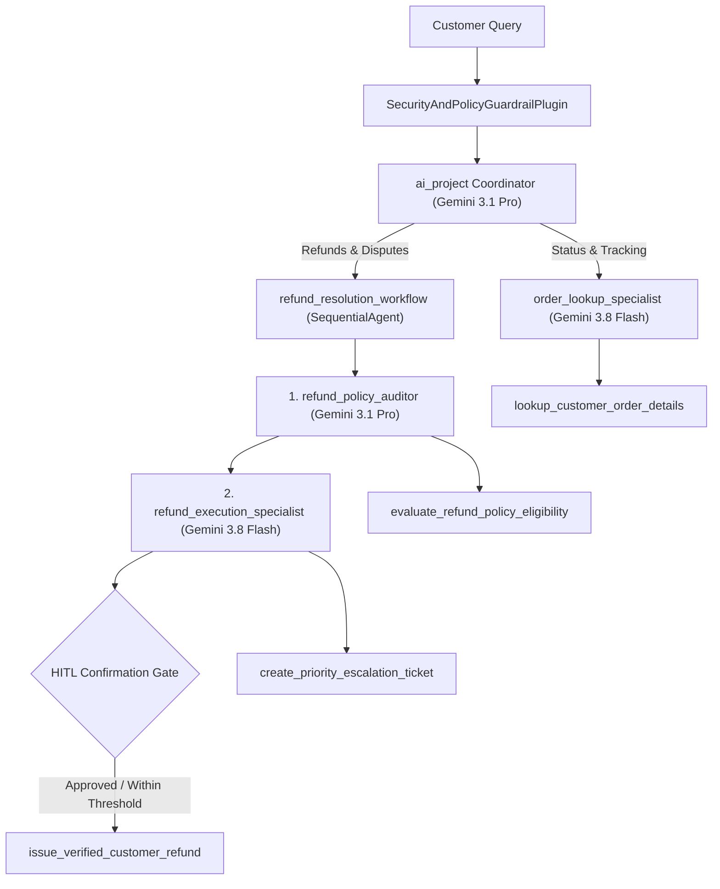

# OrderGuard — Enterprise Customer Order & Refund Resolution Agent

**Track:** Enterprise Agents (*AI in 5 Days Assessment*)  
**Framework:** Python [Google Agent Development Kit (ADK)](https://adk.dev/) (`google-adk >= 2.15.0`) + `google-agents-cli` (`v1.15.0`)

## Problem & Solution

Enterprise customer support teams face high manual volume handling routine order-status lookups alongside high-risk refund disputes, damaged-shipment escalations, and strict data-privacy requirements.

**OrderGuard (`ai_project`)** solves this with a production-grade multi-agent system built on **Google ADK**:
- Automates fast order tracking via a low-latency **Gemini Flash** specialist (`order_lookup_specialist`).
- Audits complex return-window and merchandise-category refund policies via a **SequentialAgent** pipeline (`refund_resolution_workflow`: **Gemini Pro** `refund_policy_auditor` → **Gemini Flash** `refund_execution_specialist`).
- Enforces **Human-in-the-Loop (HITL)** confirmation hooks before disbursing high-stakes financial refunds (`>= $50`) or paging `P1` responders.
- Actively scrubs sensitive **PII** (emails, payment card numbers, SSNs, phone numbers, tokens) across both structured JSON logs and async memory consolidation, with optional **Google Cloud Sensitive Data Protection (`google-cloud-dlp`)** integration.
- Ships with full **OpenTelemetry** distributed tracing, **Intent vs. Outcome** telemetry, **Secret Manager** credential injection, **Terraform** IaC, **GitHub Actions** CI/CD, and automated golden-dataset **ADK evaluations**.

---

## Architecture



---

## AgentOps Code Review Matrix Mapping (95 / 95 Points)

| Category | Criterion (5 pts) | Implementation Evidence |
|---|---|---|
| **1. Tool & Interface Design** | Comprehensive Tool Docstrings | Detailed Google-style docstrings on all 4 tools in `app/tools.py` documenting purpose, parameters, and return contracts. |
| **1. Tool & Interface Design** | Descriptive Naming | Specific verb-noun names: `lookup_customer_order_details`, `evaluate_refund_policy_eligibility`, `issue_verified_customer_refund`, `create_priority_escalation_ticket` (`app/tools.py`). |
| **1. Tool & Interface Design** | Explicit JSON Schemas | Strict Pydantic v2 schemas (`ConfigDict(extra="forbid")`, regex patterns, numeric bounds, `TOOL_JSON_SCHEMAS`) in `app/schemas.py`. |
| **1. Tool & Interface Design** | Guided Error Handling | Structured error envelopes with actionable `recovery_instruction` in `app/tools.py` + ADK `ReflectAndRetryToolPlugin` in `app/agent.py`. |
| **2. Context & Memory** | Robust System Instructions | Explicit `<AGENT_CONSTITUTION>` prompts in `app/prompts.py` defining Persona, Domain Policy Matrix, Routing Rules, and Hard Constraints. |
| **2. Context & Memory** | History Compaction | `EventsCompactionConfig` (sliding window + token threshold + `LlmEventSummarizer`), `ContextCacheConfig`, and `ContextFilterPlugin` on `App` (`app/agent.py`). |
| **2. Context & Memory** | Persistent Session State | SQL-backed `DatabaseSessionService` (Cloud SQL PostgreSQL in prod, async SQLite locally) + `PreloadMemoryTool` (`app/memory.py`, `app/app_utils/services.py`, `app/store.py`). |
| **2. Context & Memory** | Async Memory Operations | Non-blocking `asyncio.create_task()` background memory consolidation in `schedule_async_memory_consolidation` (`app/memory.py`). |
| **3. Orchestration & Logic** | Multi-Agent Patterns | Coordinator (`ai_project`) + `SequentialAgent` (`refund_resolution_workflow`: `refund_policy_auditor` → `refund_execution_specialist`) + specialist `order_lookup_specialist` (`app/agent.py`). |
| **3. Orchestration & Logic** | Strategic Model Routing | `StrategicModelRouter` (`app/routing.py`) routes fast lookups/compaction to `gemini-3.8-flash` and complex planning/policy audits to `gemini-3.1-pro-preview`. |
| **3. Orchestration & Logic** | Guardrails & Policy Plugins | `SecurityAndPolicyGuardrailPlugin(BasePlugin)` (`app/guardrails.py`) enforces prompt-injection blocking (+ optional Cloud Model Armor), audit prerequisites, and output self-evaluation. |
| **3. Orchestration & Logic** | Human-in-the-Loop Hooks | `FunctionTool(..., require_confirmation=requires_human_refund_approval)` & `requires_human_p1_escalation_approval` in `app/tools.py`. |
| **4. Observability & Tracing** | Structured JSON Logging | `CloudTraceCorrelatedJsonFormatter` (`python-json-logger`) in `app/observability.py` with zero `print()` calls. |
| **4. Observability & Tracing** | Intent vs. Outcome Capture | `IntentOutcomeObservabilityPlugin(BasePlugin)` (`app/observability.py`) explicitly logs `phase="INTENT"` before and `phase="OUTCOME"` after every agent/tool turn. |
| **4. Observability & Tracing** | Distributed Tracing | OpenTelemetry `TracerProvider` + `CloudTraceSpanExporter` (`app/observability.py`) and `otel_to_cloud=True` (`app/fast_api_app.py`). |
| **4. Observability & Tracing** | PII Redaction | `PiiRedactor` + `PiiRedactingLogFilter` (`app/pii_redaction.py`) scrubbing emails, cards, SSNs, phones, and secrets via regex + optional `google-cloud-dlp` before logging or memory writes. |
| **5. Infrastructure & CI/CD** | Automated Evaluation Suites | Golden eval dataset (`tests/eval/datasets/basic-dataset.json`), `tests/eval/eval_config.yaml`, LLM-as-judge (`tests/eval/response_quality.py`), and unit regression suite (`tests/unit/test_orderguard_rubric.py`). |
| **5. Infrastructure & CI/CD** | Infrastructure as Code | Complete Terraform modules in `deployment/terraform/` (Cloud Run v2, Cloud SQL, Secret Manager, IAM, Cloud Logging & BigQuery sinks) + GitHub Actions CI/CD (`.github/workflows/`) + `Dockerfile`. |
| **5. Infrastructure & CI/CD** | Secure Secret Management | `SecretManagerResolver` (`app/secrets.py`) using `google-cloud-secret-manager` + Cloud Run `secret_key_ref` Terraform bindings (`deployment/terraform/single-project/service.tf`); zero hardcoded keys. |

---

## Quickstart & `agents-cli` Workflow

### 1. Install Dependencies

```bash
# Install project and evaluation/lint extras via uv or agents-cli
agents-cli install
uv sync --extra eval --extra lint
```

### 2. Configure Environment

```bash
cp .env.example .env
# Authenticate with Google Cloud Application Default Credentials
agents-cli login --status
```

### 3. Run Unit Tests & Linting

```bash
uv run pytest tests/unit -v
agents-cli lint
```

### 4. Interactive Testing & Single-Prompt Smoke Test

```bash
# Non-interactive CLI execution
agents-cli run "Can you check the delivery status of order ORD-1001?"

# Launch the interactive ADK Web Playground
agents-cli playground
```

### 5. Run Automated Golden-Dataset Evaluation

```bash
agents-cli eval run \
  --dataset tests/eval/datasets/basic-dataset.json \
  --config tests/eval/eval_config.yaml
```

### 6. Provision Infrastructure (Terraform) & Deploy with `agents-cli`

```bash
# Provision single-project Cloud Run, Cloud SQL, Secret Manager, and Telemetry sinks via Terraform
agents-cli infra single-project --project YOUR_GCP_PROJECT_ID

# Or configure multi-environment GitHub Actions CI/CD via Workload Identity Federation
agents-cli infra cicd --project YOUR_GCP_PROJECT_ID

# Deploy the ADK service to Cloud Run
agents-cli deploy --project YOUR_GCP_PROJECT_ID --region us-central1
```
